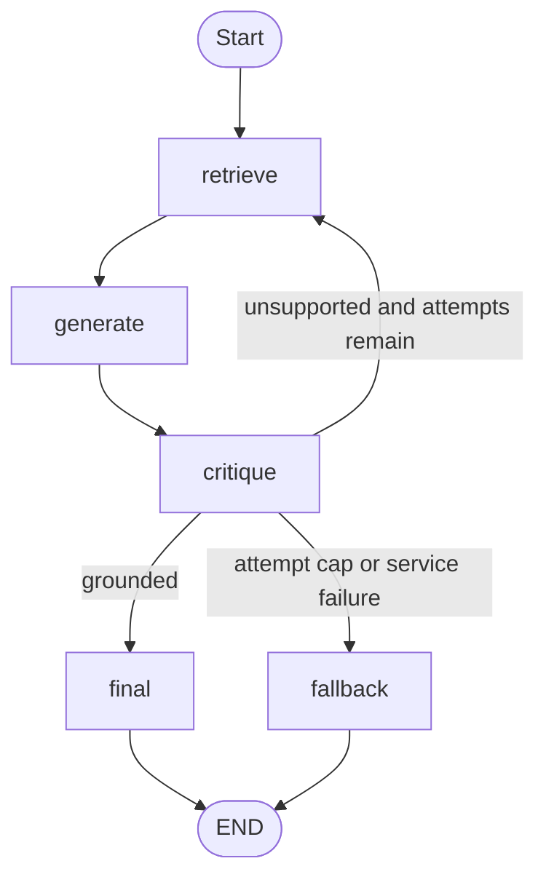

# Self-Healing RAG Pipeline

A stateful, cyclical Retrieval-Augmented Generation system with:

- LangGraph `StateGraph`
- FAISS `IndexFlatIP`
- MiniLM sentence-transformer support
- Fully offline deterministic stub mode
- Per-claim grounding
- Evidence-backed sources and citations
- Query reformulation and controlled re-retrieval
- A three-generation attempt cap
- CLI, Streamlit UI, evaluation, and offline tests

## Project status

The required implementation is complete in the generated project. The test suite
uses fakes and mocks and does not call a hosted LLM or download an embedding
model.

No evaluation numbers are claimed without running the evaluation command. The
actual results produced by the completed project are inserted into this README
by the verification workflow.

## Architecture



The final node returns the grounded answer and validated evidence. The fallback node returns exactly:

```text
I don't have enough information.
```

Fallback results never contain sources.

## Setup

Python 3.10 or later is required.

```bash
python -m venv .venv
source .venv/bin/activate
python -m pip install -e ".[dev]"
cp .env.example .env
```

Windows activation:

```powershell
.venv\Scripts\Activate.ps1
```

`requirements.txt` is the single source of truth for application and development dependencies. `setup.py` reads that file and separates runtime requirements from the `dev` extra.

## Run offline

Stub mode requires no API key and does not download a model. It uses a deterministic hashing embedder and a heuristic critic.

```bash
python main.py "How does the self-healing RAG workflow decide to retry?"
```

Verbose trace output:

```bash
python main.py --verbose "What is the retry strategy?"
```

## Run with an LLM

Set one provider and its key in `.env`:

```text
LLM_PROVIDER=openai
OPENAI_API_KEY=your-key
OPENAI_MODEL=gpt-4o-mini
```

or:

```text
LLM_PROVIDER=anthropic
ANTHROPIC_API_KEY=your-key
ANTHROPIC_MODEL=claude-3-5-haiku-latest
```

LLM mode uses the configured MiniLM sentence-transformer unless `EMBEDDING_BACKEND=hashing` is explicitly selected. The first MiniLM use may require access to the model cache or network.

## Streamlit

```bash
streamlit run app.py
```

The UI displays:

- Answer and final status
- Attempt count and run ID
- Evidence-backed sources
- One expander per attempt
- Query and top-k for each attempt
- Retrieved chunks
- Grounding verdict and critique
- Unsupported claims

The uploader accepts `.txt`, `.md`, and `.pdf` files. Rebuilding with uploads stores documents under `data/documents/` and rebuilds the FAISS index.

## Attempt and retry semantics

`MAX_ATTEMPTS=3` means three total generations:

- Attempt 1 uses the original query and `TOP_K`.
- Attempt 2 uses the critic's reformulated query and `TOP_K`.
- Attempt 3 uses the same reformulated query and `TOP_K * 2`.

If the third answer is still unsupported, the pipeline returns the exact safe fallback.

Thus, three total generations permit at most two re-retrievals. The retry strategy is logged and included in the run trace.

## Critic safety

The critic fails closed:

- API errors are retried once.
- Invalid JSON is retried once.
- A second failure sets `critique_status=critic_unavailable` and routes to fallback.
- Only the exact shared fallback sentence is treated as the fallback.
- A longer sentence beginning with similar wording is not accepted as fallback.
- Supported claims must refer to evidence chunk IDs present in the retrieved context.

## Sources and citations

Every successful result exposes:

```json
{
  "chunk_id": "document.md::page-001::chunk-000",
  "source": "document.md",
  "snippet": "..."
}
```

Critic-supported evidence is preferred. If a grounded result has no explicit evidence mapping, the retrieved chunks are used as the source list. Fallback results always have an empty source list.

## Configuration

All settings are centralized in `self_healing_rag/config.py`.

| Environment variable | Default | Purpose |
|---|---|---|
| `LLM_PROVIDER` | `auto` | `stub`, `openai`, `anthropic`, or `auto` |
| `EMBEDDING_BACKEND` | `auto` | `auto`, `hashing`, or `sentence_transformers` |
| `EMBEDDING_MODEL` | `sentence-transformers/all-MiniLM-L6-v2` | MiniLM model name |
| `OPENAI_API_KEY` | empty | OpenAI key |
| `OPENAI_MODEL` | `gpt-4o-mini` | OpenAI model |
| `ANTHROPIC_API_KEY` | empty | Anthropic key |
| `ANTHROPIC_MODEL` | `claude-3-5-haiku-latest` | Anthropic model |
| `TOP_K` | `5` | Initial retrieval depth |
| `MAX_TOP_K` | `10` | Configured retrieval safety ceiling |
| `MAX_ATTEMPTS` | `3` | Total generations |
| `CHUNK_SIZE_WORDS` | `100` | Maximum words per chunk |
| `CHUNK_OVERLAP_WORDS` | `20` | Chunk overlap |
| `DATA_DIR` | `data` | Data directory |
| `DOCUMENTS_DIR` | `data/documents` | User-document directory |
| `FAISS_INDEX_PATH` | `data/faiss_index.bin` | FAISS index path |
| `CHUNKS_METADATA_PATH` | `data/chunks.json` | JSON metadata path |
| `LOG_LEVEL` | `INFO` | Library log level (`WARNING` hides retry-strategy logs) |

## Tests

```bash
pytest -q
```

Tests use fake backends, fake retrievers, and an injected fake embedder. They do not use API keys and do not download a sentence-transformer model.

## Evaluation

The question set contains 25 document-supported questions and 8 out-of-scope questions.

Offline evaluation:

```bash
python eval/run_eval.py --mode stub
```

LLM evaluation, after configuring an API key:

```bash
python eval/run_eval.py --mode llm
```

The evaluator writes JSON and Markdown to `eval/results/`. It records each question's answer, status, attempts, sources, and claims. Metrics are:

- Claim-support rate
- Key-fact hit rate
- Expected-source hit rate
- Out-of-scope refusal rate
- Fallback rate
- Average attempts

Stub results are explicitly labeled `stub mode, heuristic critic` and must not be presented as LLM results.

<!-- BEGIN EVALUATION RESULTS --> <!-- END EVALUATION RESULTS -->

## Storage and cleanup

The FAISS index and generated chunk metadata are local artifacts and are ignored by Git. Chunk metadata is JSON; it is not persisted with pickle.

The following are excluded from the distributable ZIP:

- `.env`
- `.venv` and `venv`
- `__pycache__` and `.pyc`
- pytest and Ruff caches
- generated FAISS index files
- generated JSON chunk metadata
- `.pkl` and `.npy` artifacts
- `.DS_Store`

`data/documents/` remains trackable so users can intentionally version source documents.

## Project structure

```text
self-healing-rag/
├── app.py
├── main.py
├── requirements.txt
├── setup.py
├── pyproject.toml
├── .env.example
├── .gitignore
├── data/documents/
├── eval/
│   ├── questions.json
│   ├── run_eval.py
│   └── results/
├── self_healing_rag/
│   ├── __init__.py
│   ├── cli.py
│   ├── config.py
│   ├── critic.py
│   ├── document_loader.py
│   ├── evaluation.py
│   ├── llm.py
│   ├── logger.py
│   ├── models.py
│   ├── pipeline.py
│   ├── retriever.py
│   ├── runtime.py
│   └── sample_data.py
└── tests/
    ├── test_critic.py
    ├── test_document_loader.py
    ├── test_evaluation.py
    ├── test_pipeline.py
    └── test_retriever.py
```
